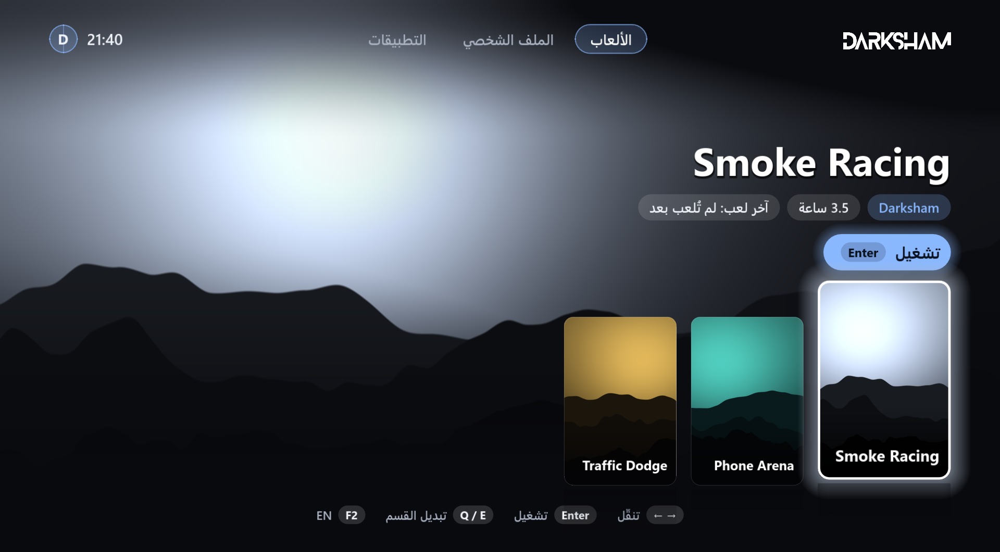
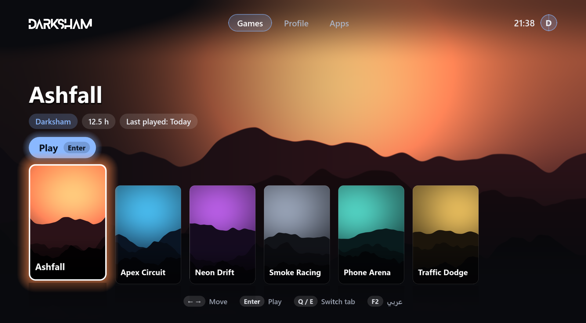

# Darksham Launcher

مشروع Darksham Engine (Godot 4.4.1 المعدّل). شاشة ألعاب ببطاقات أفقية، عربي أولاً (RTL) مع إنجليزي.

## الحالة (صادقة)
- **شاشة Games**: خلفية hero كاملة لونها من اللعبة المحددة، معلومات اللعبة وزر التشغيل على جهة البداية (يمين بالعربي)، وصف بطاقات 2:3 تحت بيتحرك ليبقى المحدد بمكانه، مع إطار تركيز وانعكاس وحركة دخول. التصميم مبني على أنماط PS5 وXbox وSteam و"10-foot UI": هامش آمن 5%، خطوط 24px وأكبر، إطار تركيز 4px.
- **Profile**: أرقام من بيانات المزوّد. **Apps**: "قريباً".
- **المزوّد الوحيد حالياً `MockProvider`**: ألعاب Darksham التجريبية. **الصور مولّدة بالشيدر (مناظر جبلية)، مو فن حقيقي**. لما نربط Steam بتنحط أغلفة الـ600x900 وصور الـhero الحقيقية بـ`GameEntry.cover` و`GameEntry.hero` والشيدر بيستخدمها لحاله.
- **انجرّب**: ويندوز (RTX 2080)، لقطات 1080p عربي وإنجليزي وللأقسام الثلاثة، واختبار تنقل آلي (9 من 9).
- **ما انجرّب**: لينكس، gamescope، جلسة تسجيل دخول، يد تحكم حقيقية (الاختبار بيضغط الأفعال برمجياً)، أداء على أجهزة ضعيفة، خطوط Sora وNoto Kufi (بتنزل للخط التالي إذا مو مثبّتة).




## تشغيل
المحرك هو `darksham-engine` (مجلد المحرك، مو بهالمستودع). افتح المشروع بالمحرك: بيضيف الإضافة `addons/` لحاله.

```bash
ENGINE --headless --path launcher --import          # مرة وحدة
ENGINE --path launcher                              # تشغيل
ENGINE --path launcher -- --lang=en --select=3      # خيارات للتجربة: --lang --select --tab --static
ENGINE --headless --path launcher --script res://tests/nav_test.gd   # اختبار التنقل
```

مفاتيح: أسهم أو D-pad/عصا = تنقل، Enter أو A = تشغيل، Q/E أو الأكتاف = تبديل القسم، F2 أو Y = عربي/إنجليزي.

## الهيكل
- `scripts/library_provider.gd`: واجهة مصدر الألعاب. كل مصدر (Steam، Lutris، Heroic) مزوّد لحاله، والشاشات ما بتعرف من وين اللعبة.
- `scripts/mock_provider.gd`: المزوّد التجريبي.
- `scripts/main.gd`: الشاشات والتخطيط. `scripts/game_card.gd`: البطاقة. `scripts/ds.gd`: الألوان والمقاسات والخطوط. `shaders/art.gdshader`: الفن (صورة حقيقية أو مولّد) للبطاقة والخلفية والانعكاس.

## الخطوة الجاية
مزوّد Steam: قراءة `libraryfolders.vdf` وملفات `appmanifest_*.acf` وإطلاق بـ`steam -applaunch <id>`. بعده الجلسة (gamescope-session-plus).
